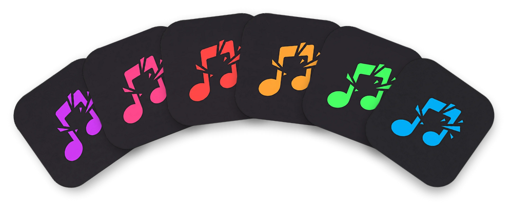
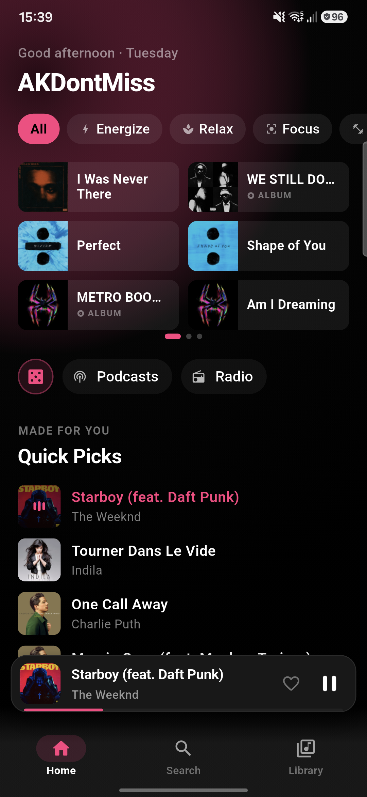
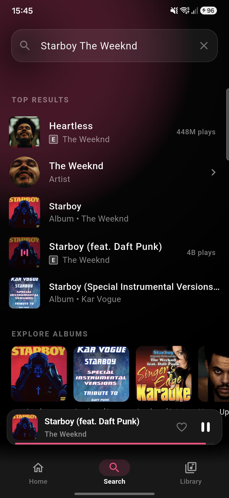
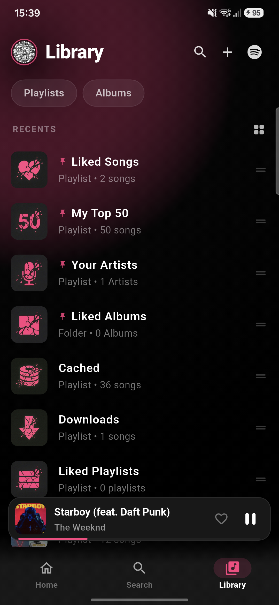
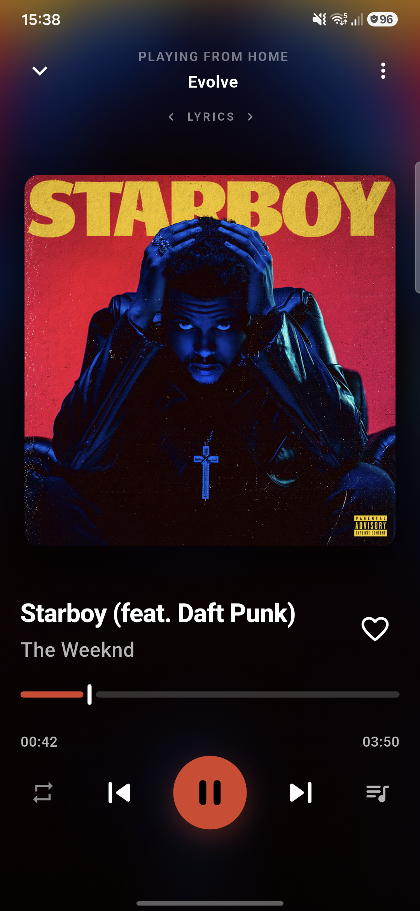
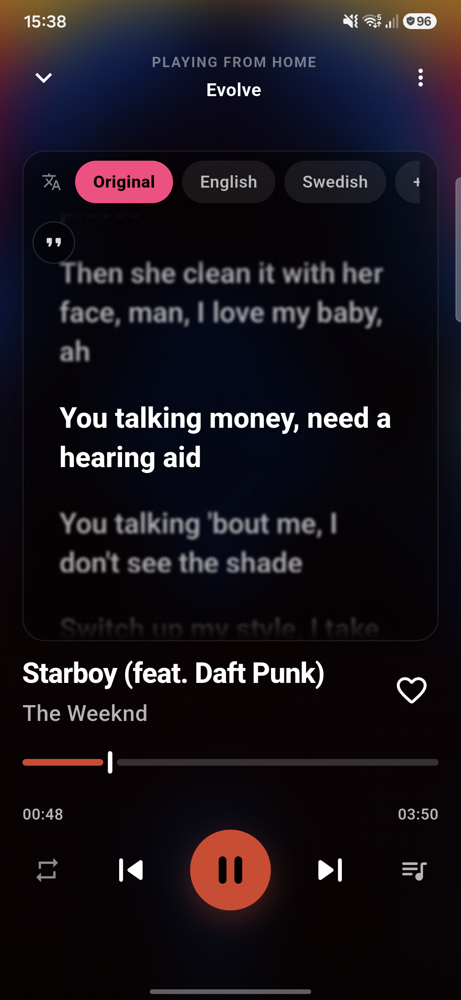
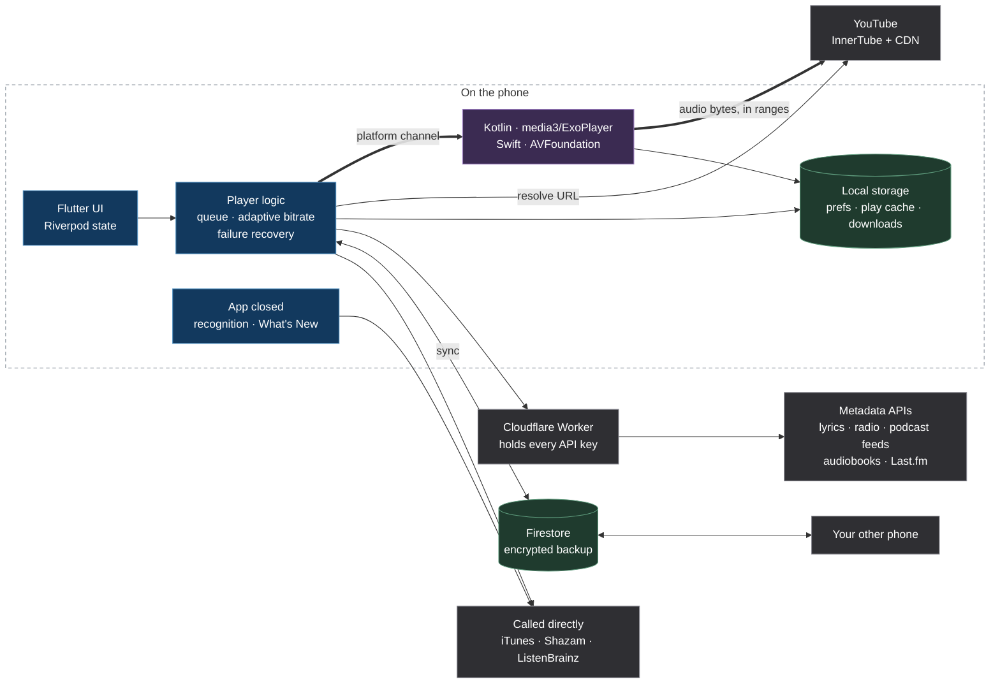

<div align="center">



# Auvy

### Music, podcasts and radio for Android and iPhone

**~115k lines of Dart** across 221 files &middot; **19 Kotlin** files on media3/ExoPlayer
&middot; **13 Swift** files on AVFoundation &middot; a **4k-line Cloudflare Worker** in front
of the third-party APIs &middot; **1,430+ tests** in 141 files

<br/>

[](../../releases)
[](LICENSE)
[](https://flutter.dev)

<br/>

[Why](#why-this-exists) &middot; [Engineering](#what-i-had-to-actually-design) &middot; [Features](#features) &middot; [Install](#install) &middot; [Privacy](#privacy) &middot; [Build](#build-it-yourself) &middot; [Licence](#licence)

</div>

---

<div align="center">







</div>

---

Auvy plays music from YouTube Music's catalogue, plus podcasts, live radio and
public-domain audiobooks. Your library stays on your phone. Cloud backup is
optional, and encrypted on the device before it is uploaded, so the store holds
ciphertext and never the key.

Android and iPhone. No ads, no tracking.

---

## Why this exists

I'm an electrical engineering student. I built this to find out what AI coding
tools are actually good for, and the only way I trusted to find out was to build
something big enough that the answer would be obvious either way. Reading about
them tells you nothing. Shipping something you have to keep working does.

A music player turned out to be a good choice, because it looks simple and
isn't. It has to keep audio running with the screen off and the OS trying to
sleep the process, survive a network that comes and goes mid-track, hold a
library in sync across devices, and stay responsive while doing all of it. None
of that shows up in a feature list, and all of it has to work before anyone uses
the app twice.

I'm aiming at embedded systems, ideally the hardware and the software together.
The hardware half is still ahead of me. What I could build on my own was the
software half of that same picture, and this is it: an app whose real work
happens under a native media pipeline rather than in its widgets.

Three problems drove almost every hard decision here, and they are the three I
expect to meet again closer to the metal.

**A boundary between two languages, which is where the interesting bugs live.**
Dart drives 19 Kotlin files (and 13 Swift files on iPhone) over platform
channels, including a data-source layer written against media3/ExoPlayer that
re-resolves a track's stream URL mid-playback without the player noticing. Every bug that took days
sat on that seam. The subtlest: shared preferences are cached in memory per
isolate, so a value Kotlin wrote stayed invisible to a running Dart isolate
until it reloaded, and the feature only appeared to work after a restart.

**Code that has to keep running when nobody is looking at it.** Audio survives
the screen going off and the OS actively trying to sleep the process. That takes a
partial wake lock plus a Wi-Fi lock held across the network read
(`WAKE_MODE_NETWORK`), and state transitions that cannot be trusted to arrive in
order. Song
recognition runs in a headless isolate with the app closed and no UI to report
into, so it has to say what it did in a log or say nothing at all.

**Budgeting against a resource you don't control.** Phone-class resources are
generous next to a microcontroller's, but the ceiling still bites: the bitrate
ladder is chosen from measured throughput rather than a fixed guess, and image
decode is sized to the box that will paint it, because the cost that hurt was
never CPU; it was texture upload after the OS trimmed the cache. The tightest
deadline in the app is lighting a lyric line within a few milliseconds of its
timestamp, and missing it looks bad rather than breaking anything, which is a
softer contract than firmware gets but the same instinct: measure, don't guess.

## What I had to actually design



Blue is Dart, purple is native (Kotlin on Android, Swift on iPhone), green is
storage, grey is outside the phone. The closed-app box is native too where it
has to be: iOS and Android each run the What's New check from their own
background scheduler.

Following one song through it, from the tap to the speaker:

1. You tap a song. The Dart side builds the queue and asks YouTube for the
   track's stream, picking an audio quality from the throughput it has
   actually measured on this connection.
2. If the track is already in the play cache or your downloads, it plays from
   disk and nothing goes over the network.
3. Otherwise the native player fetches the audio straight from YouTube's CDN.
   On Android, ExoPlayer streams it in byte ranges and keeps a copy in the play
   cache as it goes. On iPhone the whole track is fetched to a file first,
   because AVFoundation misreads YouTube's audio when it arrives as a stream.
   Either way, if the URL expires partway through, the native side asks Dart
   for a fresh one and carries on from the same byte.
4. Lyrics, artwork and other metadata come through the Worker and are cached
   on the phone, so a replay costs nothing.
5. About half a minute in, the song counts as a play: the listening data on
   the phone updates, and that is what the home feed, Weekly Discovery and
   My Top 50 are built from.
6. Before the song ends, the next one is already buffered, so the change is
   gapless.
7. If cloud backup is on, a few minutes later whatever changed is encrypted on
   the phone and uploaded. Your other phone picks it up the next time it
   opens.

One thing in there is worth pointing at.

**Audio does not go through the Worker.** Dart resolves a stream URL, then the
native side fetches the bytes itself in ranges. Proxying tens of megabytes of
audio per album through a Worker would be slow and would cost money for nothing.
The Worker only ever carries small metadata responses, which is also why it can
cache them at the edge.

The feature list further down was the easy half. These are the parts I got wrong first
and then had to understand properly.

**Caching, and what to throw away.** A phone has finite storage, so a cache is a
budget with an eviction policy, not a folder. Auvy keeps two classes of file:
auto-cached audio that is evictable, and downloads that never are. Eviction is
least-recently-used with the user's most-played tracks pinned, and it trims to a
low-water mark rather than to the limit: trimming to exactly the limit means the
next track trips it again, which I only noticed after reading a day of logs and
finding fifty evictions where there should have been eight.

**Adaptive control instead of guessing.** Audio quality is chosen from measured
throughput on a ladder of bitrates, and the decision is then frozen for the life
of a track. Freezing matters more than choosing: a re-resolve mid-track that
picks a different format hands the player a different file, and the byte offset
it was about to read no longer means anything.

**Designing for failure, not around it.** Stream URLs expire. The CDN will serve
the first megabyte and then refuse the rest. Clients get refused and have to be
rotated. Nearly all of the playback code is about detecting which of those is
happening and recovering without the listener hearing it, with bounded retries
and escalating backoff so a genuinely dead stream stops costing requests.

**An API gateway, and key custody.** A Cloudflare Worker sits in front of every
third-party API. It holds the keys, so the app ships none (a fork supplies its
own or those features sit inert), enforces a method allowlist, and caches at the
edge with per-route TTLs. Getting the cache key
wrong there is instructive: Cloudflare caches in front of the Worker, so a cached
response means your code never ran.

**Picking the storage primitive to match the question.** The Worker keeps a user
registry and rate limits, and both started on the wrong primitive. The roster
lived in KV, so counting pending accounts meant one read per key; it is now one
grouped `SELECT` in D1. The limiters ran on the Cache API, which loses increments
under concurrency; they now run in a Durable Object, single-threaded per name, so
the counter is atomic without a lock. The limiter deliberately fails open: an
unreachable counter must not lock people out of their own music.

**Sync, and the limits you find at the edges.** The library backs up encrypted to
Firestore, chunked across documents because a single document has a 1 MiB cap
that a real library quietly exceeds. Restore is the harder half: several
settings are read once at startup, so writing them to disk is not enough; the
providers holding them have to be told to look again. Two phones on one account
are harder still. The first rule I wrote was "a newer backup never overwrites
changes this phone hasn't uploaded", which sounds safe and isn't: a phone with
one unsent change skipped the other phone's newer backup and then uploaded its
own older copy over it. Now each push records what it sent, so a conflict is a
three-way merge (the other phone's changes for everything this one didn't
touch, this phone's for what it did), and the library itself merges from a
per-device log of decisions. Each push also carries what's playing, so a phone
that opens idle picks up the song where the other left off, walked forward
through the queue by the time that passed if the other was still playing.

The hardest lesson came from signing out. A catch-up that finished just after
the wipe told the emptied phone it was up to date, and its next backup sent an
empty library over the real one. The other phone still had everything and put
it back, because the rules are now explicit: a phone with none of the library
never backs up before it has restored, a phone that has the library refuses a
backup with none of it, and a wipe takes the sync records with it.

**Some signal processing.** Song recognition builds an audio fingerprint the way
Shazam's does: FFT the microphone input, pick spectral peaks, hash them into
time-invariant pairs. That part is a derived work of SongRec by way of Metrolist,
which is also why this project is GPL-3.0.

**Knowing what happened, without a debugger.** This is the piece I would point
at if asked what is unusual here. An ordinary release build can record its own
activity and export it as a redacted text file, with no cable and no developer
mode. Release builds swallow log output (each line is a synchronous platform
write, and on hot paths that costs frames), so the recorder taps the app's single
`print` interceptor above that gate. It is off until you turn it on, costs one
boolean per line while off, writes on a timer rather than per line, and strips
anything token-shaped on the way out.

Its one blind spot taught me something: the transcript held exactly what Dart
printed, so everything the Kotlin side logged was missing. Audio focus was the
clearest case. Another app taking focus is the best explanation for "the music
paused by itself", it was carefully logged natively, and it appeared zero times
in any export. A handful of rare, decisive native events (losing focus, a refused
stream) now have a narrow route into the transcript; nothing per chunk or per
tick, because that route wakes the Dart isolate.

Almost everything I fixed in the last stretch came from reading those exports
rather than guessing: a cache evicting fifty times a day where eight would do, a
setting that had silently stopped syncing for weeks, a stream format refused
because two code paths asked for it differently. None of them produced a crash
or anything a user could have described.

**Testing what a type cannot express.** There are over 1,400 tests. Some assert on the
source text itself, because several rules here are conventions the compiler
cannot check. A preference filed under the wrong type is silently skipped at
backup time, so a test derives the correct grouping instead of trusting me to
remember it. The ones that guard a past bug are verified by reintroducing the
bug and watching them fail. (The suite lives in the private development
repository; this one is the source release.)

### On the AI part

Nearly all of this was written with AI coding agents in the terminal, and I am
not going to pretend otherwise. I preferred Claude (mostly Opus, in Claude Code)
for what sits underneath: the backend, the native player, sync, and how the
features actually behave. For the front end and the look of things I preferred
Gemini and Antigravity. What I learned is where that helps and where it
does not. AI is fast at code and unreliable at judgement: it will happily write
a plausible fix for the wrong problem, and it does not know which of two
symptoms is the cause. The work that mattered was reading logs from a real device, deciding what
the actual failure was, and holding a line on scope. The bugs in here that took
longest were all cases where the code was doing exactly what it was told and the
instruction was wrong.

---

## Features

### Listen to

| | |
|---|---|
| Music | YouTube Music's catalogue: songs, albums, artists, playlists |
| Podcasts | Your shows and their new episodes, continue listening, charts and categories, resume positions, show notes |
| Radio | Thousands of live internet stations: popular in your country, trending, by genre or country, or by name |
| Audiobooks | The whole LibriVox catalogue (about 21,600 free books): sort, language and genre, saved books, continue listening, chapter progress |

### Player

| | |
|---|---|
| Gapless | Next track buffered before it's needed |
| Fade in and out | Songs fade in as they start and out when you stop |
| Skip silence | Trims dead air |
| Normalise loudness | Evens out a mixed queue |
| Equaliser | Five bands on both phones, plus pitch and tempo (Android) |
| Sleep timer | At a set time, or end of track |
| Background | Keeps playing through Doze and screen-off |
| Resume | Same track and position after a restart, or where your other phone left off |
| Your other devices | See what your other phone is playing, control it, or move the music between them, live |

### Library

| | |
|---|---|
| Collections | Playlists, albums, artists, liked songs |
| Your ordering | Sort by recently added, recently played, A to Z or most songs, or arrange your own order; custom covers. Pinned items and built-in folders sit apart |
| My Top 50 | Ranked by real listen counts |
| Keep fresh | A playlist that swaps in new suggested songs weekly or daily; yours never leave |
| Downloads | Offline, in a folder your file manager can see |
| Cache | Fills as you play, so replays cost no data |
| Import | CSV, JSON, or a backup from another player |
| Cloud backup | Encrypted, opt-in, yours only. Two phones on one account stay in step |

### Discover

| | |
|---|---|
| Home feed | Built from what you actually play |
| Weekly Discovery | A new playlist every Monday of songs you haven't saved, sized to how much and how widely you listen |
| What's New | New releases from artists you follow and new episodes of your podcasts, with optional notifications |
| Moods and genres | Picks for this time of day and the genres you play, then browse by feel |
| Charts | What's big now |
| Taste slider | How adventurous recommendations should be |

### Lyrics

| | |
|---|---|
| Synced | Line by line |
| Multiple sources | Best match wins |
| Translation | Read in your language |
| Romanisation | Japanese, Korean, Chinese, Cyrillic and more |
| Offset | Nudge the timing |
| Share cards | Turn a line into an image |

### Also in here

| | |
|---|---|
| Song recognition | Identify what's playing around you, or in another app (Android) |
| Listen Together | Listen in sync with friends in a shared room |
| Alarm | Wake to a song, not a ringtone (Android; iPhone on iOS 26 or newer) |
| Scrobbling | Last.fm, ListenBrainz |
| SideStore refresh | iPhone: SideStore refreshes Auvy by itself through a Shortcuts automation that Auvy walks you through, with a reminder if a renewal is missed |
| Android Auto | Browse and play in the car |
| Widgets | Now Playing in small, medium and large (with Up Next): where it's playing from, progress, play, skip and like; tap the song for its playlist or album. Your Mixes: four lists, one tap each. iPhone: lock screen and Control Center too |
| Siri and Shortcuts | iPhone: "Shuffle my liked songs in Auvy", "Play Weekly Discovery in Auvy", any playlist by name, search and play |
| Shortcuts on the icon | Long-press the icon for Liked Songs, Weekly Discovery, My Top 50 or Search. Android: pin any playlist to the home screen, and a Quick Settings play/pause tile |
| Open links | Spotify, Apple Music, YouTube and YouTube Music links play the match: share them to Auvy (Android), copy one and open Auvy, paste it into Search, or add the "Open in Auvy" Shortcut to the Share menu (iPhone) |
| Your year in music | Wrapped-style summary, made on device |
| Data usage | What the app spent, broken down |
| Diagnostic log | Record what the app did and export it as a redacted text file. Off by default |

### Looks

| | |
|---|---|
| Accent colour | Six of them, or follow each song's cover. The launcher icon follows your pick |
| Pure black | For OLED |
| Player | Cover shape, the glow around it (it can pulse with the music), the background, progress bar style, controls colour |
| Mini-player | Four styles: Card, Cover colour, Capsule, Fill |
| List spacing | Compact, comfortable or spacious |
| Haptics | On or off |

---

## Install

### Android

Grab the APK from [Releases](../../releases) and open it. Android will ask you to
allow installs from this source the first time.

- Needs Android 8.0 or newer. Phones only, there's no tablet layout.
- Play Protect will show **"App scan recommended — Play Protect hasn't seen this
  app before."** That is a notice about novelty, not a malware detection: it
  appears for any APK signed with a key Google has not yet seen at scale. Tap
  **Scan app** rather than skipping it. It comes back clean, and each scan is
  what eventually stops the prompt appearing for the next person.
- Updates come from the Releases tab. The app can tell you when there's a new one.

### iPhone

Install with [SideStore](https://sidestore.io) using this source:

```
https://github.com/AKDontMiss/Auvy/releases/latest/download/source.json
```

Step-by-step instructions, including the one-time SideStore setup, are in
[INSTALL.md](docs/INSTALL.md). Needs iOS 15 or newer.

---

## Known limits

- Built for phones; there's no tablet layout.
- On iPhone a few Android features aren't available (pitch, skip silence,
  recognising another app's audio), and the wake-up alarm needs iOS 26. Siri,
  Shortcuts and the widgets need iOS 17 (the SideStore refresh action, iOS 16).
  See [ios/README.md](ios/README.md).
- You need a signed-in Google account for the catalogue to work properly.
- Two phones on one account share their library, history and settings through
  the encrypted backup, so changes reach the other phone when it next syncs
  rather than instantly. What's playing is live: "Your other devices" shows
  and controls the other phone while its device list is open.
- Forks need their own keys. See below.

---

## Privacy

Your library lives on your phone. Cloud backup is off unless you turn it on, and
it's encrypted so only your account can read it.

No analytics. No tracking. No ads. Session cookies are encrypted on disk and only
ever go to the service they belong to. Diagnostic logging is off by default,
strips anything token-shaped, and never leaves the device unless you export it.

---

## Build it yourself

```sh
flutter pub get
./tool/build_release.ps1          # Android APK
./tool/build_ios.sh release       # iPhone (see ios/README.md)
```

This is the app's source release: everything needed to build, run and change
the app, and no keys. Sign-in approval, cloud backup and the metadata proxies go
through a backend (a Cloudflare Worker and a Firebase project) that is not part
of it, so a fork needs its own; without one, those features stay inert. Copy
`.env.example` to `.env` and fill it in; the build scripts pass it with
`--dart-define`, so nothing ends up in an asset.

- [docs/DEVELOPING.md](docs/DEVELOPING.md): code layout, setup, building and
  conventions.
- [ios/README.md](ios/README.md): the iOS native layer and packaging for
  SideStore.

---

## Credits

Auvy leans on a lot of other people's work.

| | |
|---|---|
| [Metrolist](https://github.com/MetrolistGroup/Metrolist) | The biggest influence by far. Approaches all through the YouTube Music client, the Shazam signature port, and the backup format Auvy can import |
| [InnerTube](https://github.com/zerodytrash/YouTube-Internal-Clients) | YouTube's internal API. How the catalogue and streams are fetched |
| [SongRec](https://github.com/marin-m/SongRec) | The fingerprinting behind song recognition. Auvy's version is a derived work |
| [InnerTune](https://github.com/z-huang/InnerTune) / OuterTune | Where Metrolist itself comes from. Several patterns trace back here |
| MusicRecognizer | Reference while building recognition |
| [LibriVox](https://librivox.org), [Internet Archive](https://archive.org) | Public-domain audiobooks and the audio hosting |
| [radio-browser.info](https://www.radio-browser.info) | The station directory behind radio |
| [LRCLIB](https://lrclib.net) and others | Synced lyrics |
| Last.fm, Deezer | Artist tags, metadata, portraits |
| iTunes Search API | Release dates for What's New, podcast search |

[NOTICE.md](docs/NOTICE.md) has the file-by-file detail of what's derived from where.
That's also why Auvy is GPL-3.0.

### Disclaimer

Auvy is a personal project. It isn't affiliated with or endorsed by YouTube,
Google, Spotify, Shazam, Last.fm, or anyone else it talks to. Trademarks
belong to their owners.

It reaches public endpoints using the same interfaces those services expose to
their own clients. It hosts nothing, bypasses no payment, and redistributes
nothing. What you do with it is on you.

---

## Licence

GPL-3.0. Full text in [LICENSE](LICENSE), and it ships inside the app too
(Settings, About, Open-source licences) so a copy travels with every build.

It has to be GPL-3.0: `lib/logic/recognition/audio_fingerprint.dart` derives from
SongRec via Metrolist, both GPL-3.0, and that covers the whole work.

Use it, study it, change it, pass it on. If you distribute a modified build, pass
on the same freedoms and make your source available to whoever gets it.

Two supplements under §7. Neither restricts what you can do, only what you keep
while doing it:

- **§7(b)** Keep the copyright notice in the source, and keep the
  *Auvy — © 2026 Akram Ahmed, GPL-3.0* line in whatever legal notices your work
  shows. Add yours next to it.
- **§7(c)** Mark a modified version as different. Change the name, package id and
  icon. The name and marks aren't licensed with the code.

Running your own build against your own Firebase project, Worker and keys is fine,
and is how a fork is meant to work.
